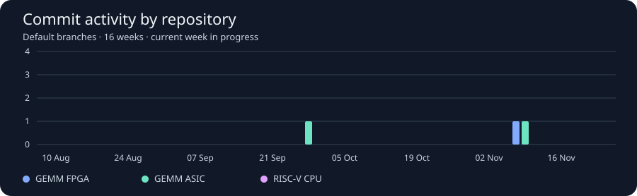

# Nguyen Cao Ky

**Digital IC Design · RTL Development · FPGA Prototyping · ASIC Physical Design**

I’m interested in how a hardware architecture becomes a physical design. I work on matrix accelerators and processor RTL, and use simulation, timing reports, and layout to understand what limits a design.

[Explore the 3D layout](https://nguyen-ky2910.github.io/WEB_GEMM_32x32_FPGT/?lang=en) · [Read the ASIC signoff report](https://github.com/nguyen-ky2910/GEMM_ASIC_SKY130/blob/main/docs/TIEN_DO_SIGNOFF.md) · [Browse repositories](https://github.com/nguyen-ky2910?tab=repositories)

## Featured project · 32 × 32 INT8 GEMM accelerator

A **weight-stationary compute array** with a Kria KV260 FPGA prototype and a hierarchical SKY130 ASIC implementation. The ASIC version integrates 32 row macros, OpenRAM SRAM macros, and an AXI wrapper.

The interactive explorer lets you inspect cells, vias, and routing layers from the project's GDS/DEF.

| What the project demonstrates | Evidence |
| --- | --- |
| **RTL and FPGA prototyping** | [RTL](https://github.com/nguyen-ky2910/GEMM_32x32_KV260_AI_ACCELERATOR/tree/main/rtl), [testbench](https://github.com/nguyen-ky2910/GEMM_32x32_KV260_AI_ACCELERATOR/tree/main/tb), and [golden model](https://github.com/nguyen-ky2910/GEMM_32x32_KV260_AI_ACCELERATOR/tree/main/golden_model) |
| **Physical design and ECO** | Hierarchical hardening with OpenLane and incremental antenna repair with OpenROAD. Antenna violations dropped from **446 to 0 pins**. The final checks report **0 Magic DRC errors** and a **matching LVS**. [ECO flow](https://github.com/nguyen-ky2910/GEMM_ASIC_SKY130/tree/main/tools/eco) · [Signoff report](https://github.com/nguyen-ky2910/GEMM_ASIC_SKY130/blob/main/docs/TIEN_DO_SIGNOFF.md) |
| **Timing and functional verification** | At **50 MHz**, the v1 post-layout report shows **+1.43 ns setup** and **+0.32 ns hold** slack on internal paths at TT. Gate-level simulation passed **three matrix configurations**. [Timing report](https://github.com/nguyen-ky2910/GEMM_ASIC_SKY130/blob/main/docs/TIEN_DO_SIGNOFF.md) · [Waveforms and comparison results](https://github.com/nguyen-ky2910/GEMM_ASIC_SKY130/tree/main/docs/evidence) |

Timing figures are post-layout STA results at TT. The project report documents SS setup and I/O hold limits separately.

**One engineering decision.** Full rerouting after antenna fixes kept introducing new violations. The team switched to incremental detailed routing in OpenROAD, then reran signoff checks in the original OpenLane flow. [ECO notes](https://github.com/nguyen-ky2910/GEMM_ASIC_SKY130/blob/main/docs/TIEN_DO_SIGNOFF.md)

## EDA tools and design workflow

| Area | Tools and technologies | Focus |
| --- | --- | --- |
| **Open-source ASIC** | **OpenLane · OpenROAD · LibreLane · Yosys · SKY130** | Synthesis, hierarchical hardening, placement, CTS, routing, and ECO |
| **Timing and physical verification** | **OpenSTA · OpenRCX · Magic · Netgen · KLayout · Icarus Verilog** | Parasitic extraction, STA, DRC/LVS, layout comparison, and gate-level simulation |
| **RTL and FPGA** | **Verilog · AMD Vivado · XSim · Kria KV260** | Datapath design, testbenches, and FPGA prototyping |
| **Commercial EDA study** | **Cadence Innovus · Synopsys IC Compiler II (ICC2) · PrimeTime** | Place-and-route workflows, setup/hold analysis, clock skew, and timing closure |
| **Scripting and reference models** | **Python · Tcl · Linux · Git** | Golden models, design-flow scripts, and report analysis |

I’m especially interested in what changes after routing. I look at how parasitics affect setup and hold, where clock skew helps, and how functional, timing, and physical checks can verify an ECO.

## More hardware projects

| Project | Focus | Explore |
| --- | --- | --- |
| **[Pipelined RISC-V CPU](https://github.com/nguyen-ky2910/RISC_V_CPU)** | Educational 32-bit, five-stage Verilog core with data forwarding and stage-level testbenches | [Architecture and simulation](https://github.com/nguyen-ky2910/RISC_V_CPU#architecture) |
| **[8 × 8 × 8 LED cube](https://github.com/nguyen-ky2910/LEDCUBE_8x8x8)** | Hardware control for a 512-LED display | [Repository](https://github.com/nguyen-ky2910/LEDCUBE_8x8x8) |

Experiments and early-stage projects

- [Mini TPU architecture](https://github.com/nguyen-ky2910/TPU) · Vivado project snapshot for exploring tiling, buffering, and AXI data movement. RTL and testbenches are pending upload.
- [Voice-controlled robot](https://github.com/nguyen-ky2910/CAR_ROBOT_CONTROL_VOICE_WED) · Embedded control project.

## GitHub activity

  
  

Contribution streak

  

Charts use public GitHub activity and refresh through [GitHub Actions](https://github.com/nguyen-ky2910/nguyen-ky2910/actions/workflows/profile-charts.yml).
