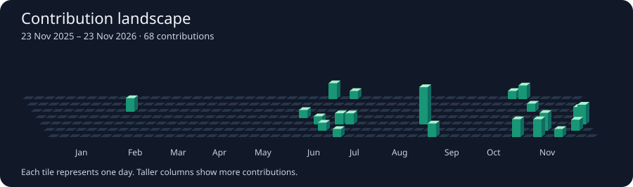

# Nguyen Cao Ky

**Digital IC Design · FPGA · ASIC · AI Accelerators · Embedded Systems**

[Repositories](https://github.com/nguyen-ky2910?tab=repositories) · [GEMM ASIC project site](https://nguyen-ky2910.github.io/WEB_GEMM_ASIC_SKY130/) · [Contribution activity](https://github.com/nguyen-ky2910#contributions-calendar)

## About me

I'm focused on **digital IC design**, especially the path from **RTL and FPGA prototyping** to **ASIC physical design**. I enjoy tracing a problem across abstraction levels, from a mismatch in a simulation waveform to a critical path in a post-route timing report.

My team's **32×32 INT8 GEMM accelerator** gave me a chance to explore that full flow, from a **Kria KV260** prototype to a **SKY130** ASIC layout. One challenge was fixing antenna violations without rerouting the entire design. The team used incremental routing in OpenROAD and brought the reported count from **446 affected pins to zero**. [ASIC signoff report](https://github.com/nguyen-ky2910/GEMM_ASIC_SKY130/blob/main/docs/TIEN_DO_SIGNOFF.md)

I also explore **processor microarchitecture** through a **five-stage RISC-V core** with data forwarding and stage-level testbenches. My current learning focus is **timing closure**, especially how clock skew, routing parasitics, and ECO changes affect setup and hold. [RISC-V project](https://github.com/nguyen-ky2910/RISC_V_CPU)

## Tech stack & tools

**RTL & FPGA prototyping**

Datapath and pipeline design, Verilog testbenches, and FPGA integration.

**ASIC implementation & physical design**

**Yosys** for synthesis, **OpenLane** for hierarchical hardening, and **OpenROAD** in **LibreLane** for incremental ECO routing. Flow stages include floorplanning, placement, clock tree synthesis, and routing. [Project flow and scripts](https://github.com/nguyen-ky2910/GEMM_ASIC_SKY130/tree/main/openlane)

**Timing, simulation & physical verification**

| Workflow | Tools and checks |
| --- | --- |
| Functional verification | **Icarus Verilog**, Verilog testbenches, **Python** golden models, and gate-level simulation |
| Post-route timing | **OpenSTA** and **OpenRCX** for setup/hold analysis using timing constraints and extracted parasitics |
| Physical checks | **Magic** for DRC, **Netgen** for LVS, and **KLayout** for GDS comparison |

**Commercial EDA · currently studying**

Studying place-and-route flows in **Innovus** and **ICC2**, and setup/hold reports, clock skew, and timing closure in **PrimeTime**.

**Programming & flow automation**

  &nbsp;&nbsp;
  &nbsp;&nbsp;
  &nbsp;&nbsp;
  &nbsp;&nbsp;
  

**Python** for reference models and analysis, **Tcl** and shell scripts for EDA flows, **C/C++** for software integration, and **Linux · Docker · Git** for development.

## GitHub at a glance

  
  

  

Language share reflects repository code size. Contribution counts and streaks reflect recorded GitHub activity.

## Repository activity

Commit counts cover each project's default branch, including commits by collaborators.

## Selected hardware projects

| Project | Focus | Explore |
| --- | --- | --- |
| **[GEMM 32×32 on Kria KV260](https://github.com/nguyen-ky2910/GEMM_32x32_KV260_AI_ACCELERATOR)** | FPGA-based matrix multiplication accelerator | [Commits](https://github.com/nguyen-ky2910/GEMM_32x32_KV260_AI_ACCELERATOR/commits/) |
| **[GEMM ASIC SKY130](https://github.com/nguyen-ky2910/GEMM_ASIC_SKY130)** | GEMM accelerator implementation using the SKY130 ASIC flow | [Project site](https://nguyen-ky2910.github.io/WEB_GEMM_ASIC_SKY130/) |
| **[RISC-V CPU](https://github.com/nguyen-ky2910/RISC_V_CPU)** | RISC-V processor design and RTL development | [Commits](https://github.com/nguyen-ky2910/RISC_V_CPU/commits/) |
| **[TPU](https://github.com/nguyen-ky2910/TPU)** | Tensor processing and matrix-compute architecture | [Commits](https://github.com/nguyen-ky2910/TPU/commits/) |

More projects

- [8×8×8 LED Cube](https://github.com/nguyen-ky2910/LEDCUBE_8x8x8) · LED cube control
- [Voice-controlled car robot](https://github.com/nguyen-ky2910/CAR_ROBOT_CONTROL_VOICE_WED) · Embedded control
- [GEMM FPGA project website source](https://github.com/nguyen-ky2910/WEB_GEMM_32x32_FPGT)

## Contribution landscape

Charts are refreshed daily by [GitHub Actions](https://github.com/nguyen-ky2910/nguyen-ky2910/actions/workflows/profile-charts.yml).
